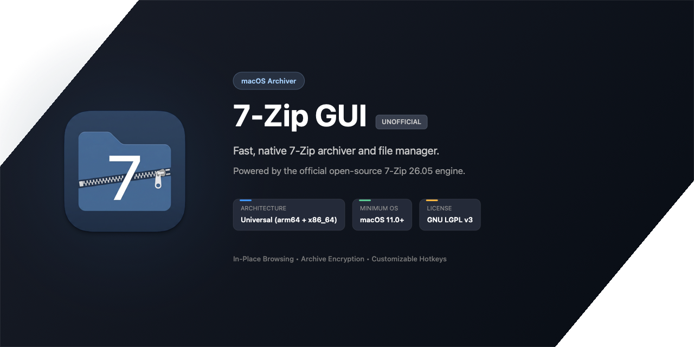
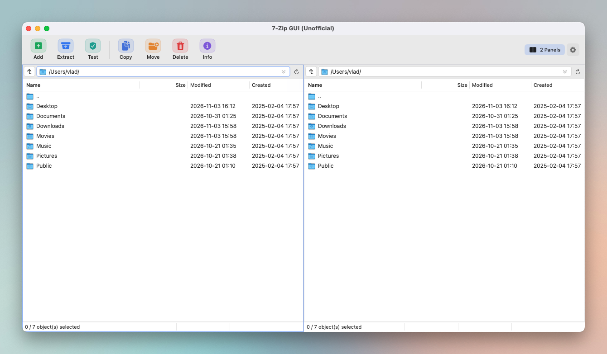

# 7-Zip GUI (Unofficial)

> Fast, native, dual-pane 7-Zip archiver and file manager for macOS.  
> Powered by the official open-source 7-Zip 26.05 engine.

[-blue?logo=apple)](https://www.apple.com/macos/)
[](https://www.7-zip.org/)
[](https://www.gnu.org/licenses/lgpl-3.0.html)

---

<!-- Project Banner -->
<p align="center">
  
</p>


## ✨ Features

- **Dual-Pane & Single-Pane File Manager**: Classic 7-Zip / Total Commander dual-pane workflow with full keyboard navigation.
- **In-Place Archive Browsing**: Open and browse inside `.7z`, `.zip`, `.rar`, `.tar`, `.dmg`, `.iso` directly without extracting everything to disk.
- **Archive Creation**: Create `.7z`, `.zip`, `.tar`, `.gz`, `.bz2`, `.xz` archives with configurable compression levels, encryption passwords, solid blocks, and encrypted headers.
- **Archive Extraction & Testing**: Extract full archives or selected items with overwrite controls, and verify integrity with **Test Archive**.
- **Customizable Hotkeys**: Built-in keyboard shortcuts recorder for archive operations, panel toggling, and file management.
- **Native Look & Feel**: Supports System, Light, and Dark appearance, with both Modern macOS and Classic 7-Zip toolbar icon styles.

---

## 📸 Screenshot

<p align="center">
  
</p>

---

## 🚀 Getting Started

### System Requirements
- macOS 11.0 (Big Sur) or higher.
- Native Universal binary: Apple Silicon (`arm64`) & Intel (`x86_64`).

### Installation & First Launch

Download the latest release from the [Releases](https://github.com/your-username/7zip-mac-gui/releases) page, move `7-Zip GUI.app` to your `/Applications` folder, and open it.

> [!NOTE]
> **macOS Gatekeeper ("Unidentified Developer" / "Cannot be opened"):**  
> Because this is a community open-source project without a paid \$99/year Apple Developer ID certificate, macOS Gatekeeper may show a warning on first launch.
>
> You can launch the app using any of these standard methods (required only once):
> 1. **Right-click** (or `Control`-click) `7-Zip GUI.app` in Finder → select **Open** → click **Open** in the dialog.
> 2. **System Settings:** Go to **System Settings → Privacy & Security**, scroll down to the Security section, and click **Open Anyway**.
> 3. **Terminal:** Strip the download quarantine attribute:
>    ```bash
>    xattr -cr "/Applications/7-Zip GUI.app"
>    ```

### Building from Source

1. Clone the repository:
   ```bash
   git clone https://github.com/your-username/7zip-mac-gui.git
   cd 7zip-mac-gui
   ```

2. Open the project in Xcode:
   ```bash
   open "7-Zip GUI/7-Zip GUI.xcodeproj"
   ```

3. Build & Run (`Cmd + R`) or build from the command line:
   ```bash
   xcodebuild -project "7-Zip GUI/7-Zip GUI.xcodeproj" -scheme "7-Zip GUI" -configuration Release build
   ```

---

## ⌨️ Default Keyboard Shortcuts

| Shortcut | Action |
| :--- | :--- |
| `⇧` + `⌘` + `E` | Extract Archive |
| `⇧` + `⌘` + `A` | Add to Archive |
| `⇧` + `⌘` + `T` | Test Archive Integrity |
| `F5` | Copy To... |
| `F6` | Move To... |
| `F7` | Create Folder |
| `F9` | Toggle Dual-Pane Mode |
| `⌘` + `⌫` | Move to Trash |
| `⌘` + `R` | Refresh Panel |
| `⇧` + `⌘` + `.` | Toggle Hidden Files |
| `⌘` + `,` | Preferences / Hotkeys |

*(All hotkeys can be customized in **Settings → Hotkeys**)*.

---

## ⚖️ Legal Disclaimer & License

- **7-Zip Engine**: Powered by 7-Zip CLI (`7zz`), developed and copyrighted by **Igor Pavlov** under the **GNU LGPL** license (with unRAR restrictions and BSD clauses).
- **7-Zip GUI (Unofficial)** is an independent, community-developed open-source macOS graphical interface and is **not** affiliated with, endorsed by, or an official release of the 7-Zip project or Igor Pavlov.
- 7-Zip™ is a trademark / software identifier belonging to Igor Pavlov.
